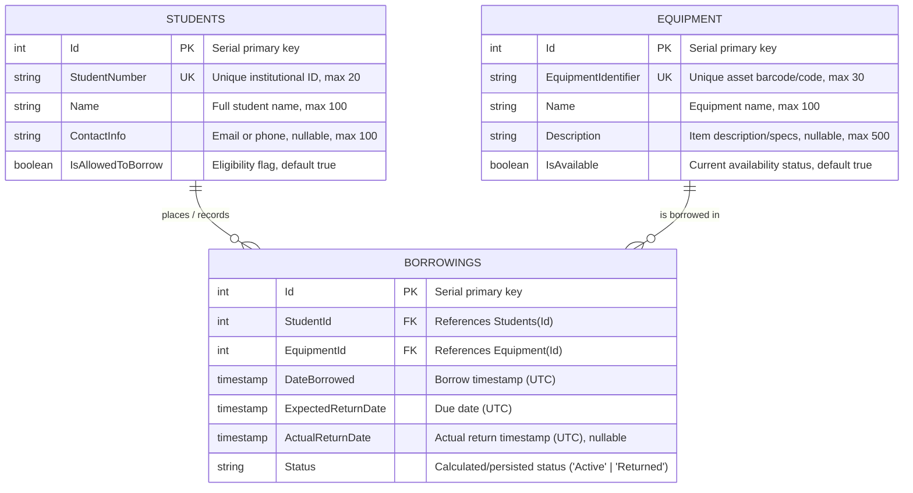

# Entity-Relationship Diagram (ERD)
## Campus Equipment Borrowing System — Laboratory Activity 4

This document defines the relational database schema implemented in **PostgreSQL 18** via **Entity Framework Core 8** for Laboratory Activity 4.

---

### 1. Conceptual Model Diagram



---

### 2. Relational Schema & Tables

#### Table: `Students`
| Column | Type | Constraints | Description |
|---|---|---|---|
| `Id` | `integer` | `PRIMARY KEY GENERATED BY DEFAULT AS IDENTITY` | Surrogate primary key |
| `StudentNumber` | `varchar(20)` | `NOT NULL`, `UNIQUE INDEX` | Institutional student ID (e.g., S1001) |
| `Name` | `varchar(100)` | `NOT NULL` | Student full legal name |
| `ContactInfo` | `varchar(100)` | `NULLABLE` | Institutional email or contact number |
| `IsAllowedToBorrow` | `boolean` | `NOT NULL`, `DEFAULT true` | Borrowing eligibility flag (BR-02, UC-14) |

#### Table: `Equipment`
| Column | Type | Constraints | Description |
|---|---|---|---|
| `Id` | `integer` | `PRIMARY KEY GENERATED BY DEFAULT AS IDENTITY` | Surrogate primary key |
| `EquipmentIdentifier` | `varchar(30)` | `NOT NULL`, `UNIQUE INDEX` | Barcode / Asset code (e.g., EQ-001) |
| `Name` | `varchar(100)` | `NOT NULL` | Descriptive equipment title |
| `Description` | `varchar(500)` | `NULLABLE` | Technical specifications or notes |
| `IsAvailable` | `boolean` | `NOT NULL`, `DEFAULT true` | Immediate availability flag |

#### Table: `Borrowings`
| Column | Type | Constraints | Description |
|---|---|---|---|
| `Id` | `integer` | `PRIMARY KEY GENERATED BY DEFAULT AS IDENTITY` | Surrogate primary key |
| `StudentId` | `integer` | `NOT NULL`, `FOREIGN KEY` | References `Students(Id)` (`ON DELETE RESTRICT`) |
| `EquipmentId` | `integer` | `NOT NULL`, `FOREIGN KEY` | References `Equipment(Id)` (`ON DELETE RESTRICT`) |
| `DateBorrowed` | `timestamp with time zone` | `NOT NULL` | Date and time checked out |
| `ExpectedReturnDate` | `timestamp with time zone` | `NOT NULL` | Due date, strictly later than DateBorrowed (BR-11) |
| `ActualReturnDate` | `timestamp with time zone` | `NULLABLE` | Return date timestamp; null while active (BR-13) |

---

### 3. PostgreSQL Database Constraints & Indexes

1. **Unique Student Number**:
   ```sql
   CREATE UNIQUE INDEX "IX_Students_StudentNumber" ON "Students" ("StudentNumber");
   ```
2. **Unique Equipment Identifier**:
   ```sql
   CREATE UNIQUE INDEX "IX_Equipment_EquipmentIdentifier" ON "Equipment" ("EquipmentIdentifier");
   ```
3. **Single-Active-Borrowing Partial Unique Index (BR-10)**:
   Guarantees at the database engine level that no piece of equipment can have more than one active loan at the same time:
   ```sql
   CREATE UNIQUE INDEX "IX_Borrowings_EquipmentId_Active" 
   ON "Borrowings" ("EquipmentId") 
   WHERE "ActualReturnDate" IS NULL;
   ```
4. **Foreign Key Integrity**:
   - `FK_Borrowings_Students_StudentId` prevents deleting a student who has active or historical borrowings.
   - `FK_Borrowings_Equipment_EquipmentId` prevents deleting equipment referenced by borrowing records.
