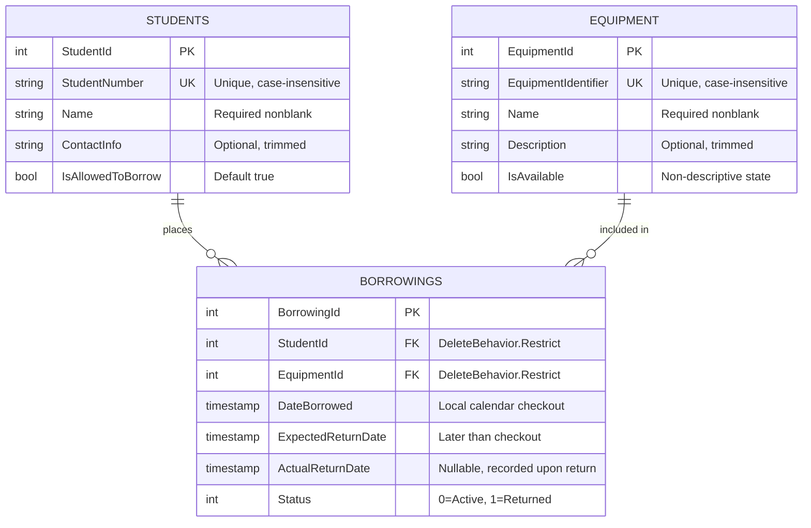
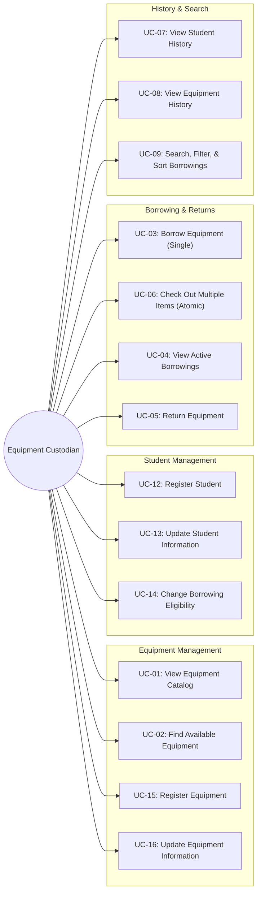

Equipment Borrowing System


 1. Solution Structure

-EquipmentBorrowing.Domain:
  Contains core business entities (`Student`, `Equipment`, `Borrowing`) and domain enums (`BorrowingStatus`). This layer holds pure business rules and data models. It has zero external references or dependencies on other projects or database frameworks.

-EquipmentBorrowing.Application: 
  Contains business use cases (`BorrowEquipmentService`) and repository abstractions (`IStudentRepository`, `IEquipmentRepository`, `IBorrowingRepository`). It handles workflow orchestrations, guard condition validation, and data manipulation rules while referencing only the Domain project.

-EquipmentBorrowing.Infrastructure:
  Contains technical implementation details, such as in-memory data persistence classes (`InMemoryStudentRepository`, `InMemoryEquipmentRepository`, `InMemoryBorrowingRepository`). It implements the interface contracts defined in the Application layer and references both Domain and Application.

-EquipmentBorrowing.Console:
  Serves as the entry point application to demonstrate success and failure borrowing workflows. It references Domain, Application, and Infrastructure to configure runtime dependencies.

-EquipmentBorrowing.Tests:
  Contains xUnit test classes (`UnitTest1.cs`) used to verify unit behavior across Application and Domain components without needing external services running.


 2. Dependency Direction

Executable / Future UI
          │
          ▼
     Application
       │      ▲
       ▼      │
     Domain   │
          │   │
          └───┘
     Infrastructure


-Domain depends on nothing.

-Application depends only on Domain.

-Infrastructure depends on both Application (for repository interfaces) and Domain (for entities).

-Console (Executable) depends on Domain, Application, and Infrastructure.

Use Case Mapping
-Actor: Student
-Use Case: Borrow Equipment
-Application Service: BorrowEquipmentService
-Domain Objects Used: Student, Equipment, Borrowing, BorrowingStatus
-Repository Interfaces Used: IStudentRepository, IEquipmentRepository, IBorrowingRepository
-nfrastructure Implementations Used: InMemoryStudentRepository, InMemoryEquipmentRepository, InMemoryBorrowingRepository

4. Reflection

1. Why is it important that the Domain project has no dependencies on other projects?

-Well the Domain represents the core business rules and logic of the system, so by keeping it free of external dependencies, 
business rules remain completely unaffected by technical changes like UI updates, framework upgrades, or database switches.

2. What would happen to BorrowEquipmentService if we replaced in-memory storage with SQLite?

-If you change it I think nothing inside BorrowEquipmentService would need to change. Because the service depends solely on abstractions (IStudentRepository, 
IEquipmentRepository, IBorrowingRepository), and base on my research and experience, we only need to create new SQLite repository implementations inside the Infrastructure layer 
and pass them into the service constructor.

3. Why do repository interfaces live in Application while their implementations live in Infrastructure?

-Well this one follows the Dependency Inversion Principle. The Application layer defines the contract (what data operations it needs) 
without caring how data is stored. The Infrastructure layer fulfills that contract by providing concrete technical 
implementations (in-memory lists, SQLite, PostgreSQL).

4. If a future Avalonia UI project is added, which projects will it need to reference and why?

-I think It will need to reference Application in order to execute service operations like borrowing, 
Domain in order to work with domain models like Student or Equipment, and Infrastructure 
to instantiate and inject the concrete repository implementations into the services at startup.

5. How does this 4-layer architecture make the system easier to test using unit tests?

-It allows unit tests in EquipmentBorrowing.Tests to test core business logic in isolation. 
Because BorrowEquipmentService receives repository interfaces via dependency injection, 
tests can easily supply fast mock or in-memory repositories without setting up or wiping a real database.


 Laboratory Activity 2 — Avalonia UI and MVVM

1. Desktop Project

EquipmentBorrowing.Desktop is the presentation layer added in Laboratory Activity 2. It contains
Avalonia Views (XAML) under Views/ and ViewModels under ViewModels/, along with the application's
composition root (App.axaml.cs), which wires dependency injection for the whole application.

The Desktop project references Application, Infrastructure, and Domain so it can display data,
collect user input, and invoke existing application services. However, Domain and Application have
no reference to Avalonia or to the Desktop project at all — they remain completely independent of
the UI framework, exactly as they were in Laboratory Activity 1. This means the borrowing rules
implemented in Activity 1 did not need to change or be duplicated to support the new interface.

 2. Updated Architecture

Avalonia View
     │  Binding / Command
     ▼
ViewModel
     │  Application Operation
     ▼
Application Service
     │
     ├──────────► Domain
     ▼
Repository Interface
     ▲
     │
Infrastructure Implementation

- View (EquipmentView.axaml, BorrowingsView.axaml) binds to ViewModel properties and commands.
- ViewModel (EquipmentViewModel, BorrowingsViewModel, MainWindowViewModel) holds presentation
  state and calls Application services — it contains no business rules of its own.
- Application Service (BorrowEquipmentService, ReturnEquipmentService) coordinates Domain objects
  and Repository interfaces to perform the actual use case.
- Repository Interface / Infrastructure Implementation (unchanged from Activity 1) still provide
  data access through in-memory repositories, registered as Singletons in the Desktop project's
  composition root so all ViewModels share the same underlying data.

3. Borrow Equipment Flow

The user selects a student and a piece of equipment on the Equipment view, then presses
"Borrow Equipment." This triggers EquipmentViewModel's BorrowCommand. The ViewModel first performs
presentation validation — checking that both a student and equipment were actually selected — and
displays a message if not. If both are selected, it calls BorrowEquipmentService.BorrowAsync(),
passing only the selected student and equipment IDs.

The service performs the real business validation: confirming the student exists and is allowed to
borrow, the equipment exists and is available, and the student has not reached the maximum active
borrowings, all using the repository interfaces from Activity 1. If every rule passes, it creates a
new Borrowing, marks the equipment unavailable, and persists both changes. The result (success or a
specific failure reason) is returned to the ViewModel, which displays it as a status message and
reloads the equipment list so the updated availability is immediately visible.

 4. Return Equipment Flow

The user switches to the Active Borrowings view (which reloads its list from the repository each
time it is opened, ensuring it reflects the current state), selects an active borrowing, and presses
"Return Equipment." This triggers BorrowingsViewModel's ReturnCommand, which first checks that a
borrowing was actually selected. It then calls ReturnEquipmentService.ReturnAsync() with the
selected borrowing's ID.

The service locates the borrowing, verifies it has not already been returned, marks it as Returned,
marks the associated equipment as available again, and persists both updates through the repository
interfaces. The result is returned to the ViewModel, which displays a success or failure message and
reloads the active borrowings list. Navigating back to the Equipment view reflects the newly
available equipment as well, since that list is also reloaded on navigation.

 5. Architectural Reflection

1. Why should the View not call a repository directly?
   
   -Well if the View called the repository directly, it would basically be doing the job that's supposed to belong to the Application layer. 
   The View would need to know how data is stored (like it's a List right now, but what if we switch to SQLite later?), and worse, 
   it would skip all the validation rules like checking if the student is allowed to borrow or if the equipment is available. 
   That logic has to run somewhere, and it shouldn't be inside a button click. Keeping the View away from the repository 
   means the View only worries about what to show and what to bind, not how the data actually works.

2. Why should business rules not be implemented in the ViewModel?
   
   -Because then we'd basically have the same rule written in two different places, once in BorrowEquipmentService 
   from Activity 1, and again in the ViewModel if we tried to check things like equipment.IsAvailable ourselves before 
   calling the service. If we ever needed to change a rule (like increasing the max borrow limit from 3 to 5), 
   we'd have to remember to update it in both places, and it's really easy to forget one and end up with bugs. 
   Also, the ViewModel is supposed to be about the UI side of things, not about deciding whether a transaction is actually allowed to happen.

3. What is the responsibility of the ViewModel?
  
  -Basically the ViewModel is the "middleman" between the View and the actual application logic. 
   It holds the stuff the screen needs to show (like the equipment list, the selected student, status messages), 
   and it has the commands that get triggered when the user clicks something. 
   But when it comes to actually deciding if a borrow/return is allowed, it just passes that off to the Application service and waits for the result. 
   So its job is more like "manage what's on screen and talk to the services," not "decide if the operation is valid."

4. Why can the existing Application layer work without knowing that Avalonia is being used?
   
   -Because BorrowEquipmentService and the repository interfaces don't reference Avalonia anywhere, 
   they only depend on the Domain layer and their own interfaces. They don't care who's calling them, 
   whether it's a console app like in Activity 1, this Avalonia UI now, or even a website someday. 
   As long as whoever's calling BorrowAsync() gives it a student ID and equipment ID, 
   it works the same way regardless of what kind of interface is on top of it.

5. What advantage is gained from registering dependencies in one composition point?
   
   -Having everything registered in one place (App.axaml.cs, in ConfigureServices) 
   makes it way easier to see the whole picture of how the app is wired together, 
   instead of having new SomeRepository() scattered randomly across different files. 
   If we want to change something , like switching a repository to Transient instead of Singleton, 
   or swapping in a different implementation later, we only need to touch that one spot instead of hunting through the whole project.

6. If the in-memory repository were replaced by SQLite later, which parts of the current
   interface should remain largely unchanged?
  
  -Pretty much everything except the Infrastructure folder. 
   The Views, the ViewModels, and the Application services (BorrowEquipmentService, ReturnEquipmentService) 
   never actually mention "in-memory" anywhere in their code, they only use the repository interfaces. 
   So if we swapped in SQLite, we'd just need to create new repository classes like SqliteEquipmentRepository that 
   implement the same interfaces, and change the registration line in App.axaml.cs to point to those instead. 
   Everything else stays the same, which honestly is the whole point of doing it this way.


    Laboratory Activity 3 - SQLite and Entity Framework Core


1. Relational Database Design

The database has three tables that mirror the domain models from Activity 1. Students and
Equipment are both referenced by Borrowings through foreign keys, so a borrowing record always
points back to exactly one student and one equipment item instead of repeating their information.

STUDENTS
StudentId PK
Name
IsAllowedToBorrow

EQUIPMENT
EquipmentId PK
Name
IsAvailable

BORROWINGS
BorrowingId PK
StudentId FK
EquipmentId FK
DateBorrowed
ExpectedReturnDate
Status

Students to Borrowings is one to many, and Equipment to Borrowings is one to many as well. A
student can have several borrowing records over time, and a piece of equipment can appear in
several borrowing records too, but each borrowing only ever belongs to one student and one
equipment item. The diagram is saved at docs/database-diagram.png.

Name fields on Students and Equipment are required with a max length, and the two foreign keys
on Borrowings use restrict delete behavior so a student or equipment record can't be removed while
it still has borrowing history attached. Indexes were added on StudentId and EquipmentId inside
Borrowings since those are the columns we filter on most often.

2. SQLite and EF Core

We added the Microsoft.EntityFrameworkCore.Sqlite, Microsoft.EntityFrameworkCore.Design, and
Microsoft.EntityFrameworkCore.Tools packages to the Infrastructure project. A new Persistence
folder was created to hold the DbContext and the entity configuration classes, and the old
in-memory repositories were replaced with EF Core backed versions that still implement the same
interfaces from Activity 1.

3. DbContext

EquipmentBorrowingDbContext represents the database session for the whole application. It exposes
a DbSet for Students, Equipment, and Borrowings, and it applies all the entity configurations
automatically through OnModelCreating. It gets its connection string through its constructor the
same way everything else in this project receives its dependencies, so it never hardcodes where
the database file actually lives. It is only ever used inside the Infrastructure repositories and
inside App.axaml.cs, never inside a View or a ViewModel.

4. Repository Transition

Before this activity, IEquipmentRepository, IStudentRepository, and IBorrowingRepository were all
implemented by classes that stored everything in a plain C# List, which meant the data disappeared
the moment the app closed. Those were replaced with EfEquipmentRepository, EfStudentRepository,
and EfBorrowingRepository, which now read from and write to the SQLite database through the
DbContext. Since BorrowEquipmentService, ReturnEquipmentService, and every ViewModel only ever
depended on the repository interfaces and never on the concrete in-memory classes, none of that
code had to change at all for this swap to work.

5. Migration Process

The initial migration was created through the Package Manager Console with the default project set
to EquipmentBorrowing.Infrastructure, using

Add-Migration InitialCreate -Project EquipmentBorrowing.Infrastructure -StartupProject EquipmentBorrowing.Desktop

and then applied with

Update-Database -Project EquipmentBorrowing.Infrastructure -StartupProject EquipmentBorrowing.Desktop

The app also calls dbContext.Database.Migrate() automatically when it starts up, so the database
gets created and any pending migrations get applied without anyone needing to run those commands
manually.

6. Generated SQL

LINQ Query
Retrieve all equipment, used by EquipmentViewModel to populate the Equipment screen.

_context.Equipment.AsNoTracking().ToListAsync(cancellationToken);

Generated SQL

SELECT "e"."EquipmentId", "e"."Name", "e"."IsAvailable"
FROM "Equipment" AS "e"

Explanation
This just pulls every column from the Equipment table with no filtering at all, which matches the
plain LINQ call with no Where clause.

LINQ Query
Retrieve active borrowings, used by BorrowingsViewModel to populate the Active Borrowings screen.

_context.Borrowings.AsNoTracking().Where(b => b.Status == BorrowingStatus.Active).ToListAsync(cancellationToken);

Generated SQL

SELECT "b"."BorrowingId", "b"."DateBorrowed", "b"."EquipmentId", "b"."ExpectedReturnDate",
       "b"."StudentId", "b"."Status"
FROM "Borrowings" AS "b"
WHERE "b"."Status" = 0

Explanation
The Where clause in the LINQ query becomes an actual SQL WHERE clause here, so the filtering
happens inside SQLite itself instead of loading every borrowing into memory first and filtering
in C#. The 0 is the integer value EF Core stores for BorrowingStatus.Active.

Both of these were confirmed by temporarily enabling EF Core logging on the DbContext with LogTo
and watching the output while navigating between the Equipment and Active Borrowings screens.

7. Tracking Decisions

GetAllAsync and the active borrowings query both use AsNoTracking because they only exist to show
data on screen, nothing about them changes an entity afterward, so there's no reason for EF Core to
keep watching those objects for changes. The GetByIdAsync call that runs right before UpdateAsync
does not use AsNoTracking, because the equipment or borrowing returned from that call is about to
get modified (MarkAsBorrowed, MarkAsReturned) and EF Core needs to actually be tracking it to know
what changed once SaveChangesAsync runs.

8. Persistence Demonstration

We tested this by borrowing a piece of equipment, confirming it showed up right away on the Active
Borrowings screen, then fully closing the app and opening it again. The borrowing was still there
after restarting, which proved the data was actually coming from the SQLite file and not just
sitting in memory like it was in Activity 2. We repeated the same test for returning equipment,
closing and reopening the app again afterward, and the returned state was still correct too.

9. Architectural Reflection

1. Why did the application not need to be completely rewritten when SQLite was introduced?

-Because everything above Infrastructure only ever talked to the repository interfaces, not the
actual in-memory classes. So swapping what's behind those interfaces was basically the only
change that had to happen. Domain, Application, and the whole Desktop UI stayed exactly the same.

2. Why should the ViewModel not use DbContext directly?

-Same reason as not letting the View touch a repository directly back in Activity 2. If the
ViewModel used DbContext itself it would be tightly stuck to EF Core and SQLite specifically, and
it would also probably end up skipping the validation rules that are supposed to live in the
Application services. The ViewModel's job is to manage the screen, not to know how data gets saved.

3. What responsibility does the repository implementation now perform?

-It's the bridge that actually talks to the database. Before it was just reading and writing to a
List, now it translates the repository interface calls into real EF Core queries against
EquipmentBorrowingDbContext, which then get turned into actual SQL that runs against SQLite.

4. What is the purpose of an EF Core migration?

-It keeps a record of how the database schema should look and how it changed over time, so the
schema can be recreated or updated automatically instead of someone manually writing CREATE TABLE
statements by hand. It's basically version control for the database structure.

5. Why are foreign keys important in the borrowing database?

-They make sure a borrowing record can't point to a student or equipment item that doesn't
actually exist. Without them nothing would stop a bad StudentId or EquipmentId from being saved,
and the whole point of referencing instead of duplicating data falls apart if the reference isn't
actually enforced.

6. Why can a read only query benefit from AsNoTracking()?

-Because EF Core normally keeps track of every entity it loads in case you change it later, and
that tracking costs memory and a bit of performance. If we're only displaying the data and never
going to modify those exact objects, there's no reason to pay that cost, so AsNoTracking just skips
it and makes the query a little faster and lighter.

7. What would happen to the rest of the application if the SQLite implementation were replaced
   later by another database provider?

-Pretty much the same thing that happened when we moved from in-memory to SQLite in this activity.
Only the Infrastructure project would need new repository classes and a different connection setup
in App.axaml.cs, since everything else only depends on the repository interfaces and has no idea
SQLite was ever involved in the first place.


---

# Laboratory Activity 4 — Advanced Data-Driven Workflows and PostgreSQL Integration

## 1. Activity Overview & Objectives

In Laboratory Activity 4, the Campus Equipment Borrowing System transitions its operational database from SQLite to **PostgreSQL**, retains its working single-item borrowing and return functions, and is extended with:
- Persistent Student Management (Registration, Updating, and Eligibility Toggling: Permit / Restrict).
- Persistent Equipment Management (Registration, Updating, and Availability Protection).
- Coordinated Atomic Multi-Item Checkout (at least 2 items, limit of 3 active loans, all-or-nothing rollback).
- Historical Tracking and Retrieval Workflows (Student Borrowing History, Equipment Borrowing History, and Multi-Criteria Borrowing Search, Filtering, and Sorting).
- Full preservation of clean 4-layer / MVVM architectural boundaries:
  `Avalonia View` $\rightarrow$ `ViewModel` $\rightarrow$ `Application Service` $\rightarrow$ `Repository Abstraction` $\rightarrow$ `EF Core Infrastructure` $\rightarrow$ `PostgreSQL`.

---

## 2. PostgreSQL Transition & Secret-Free Configuration

### Migration from SQLite to PostgreSQL
The SQLite EF Core provider was replaced with `Npgsql.EntityFrameworkCore.PostgreSQL` (v10.0.3). All database interactions are now performed against a local or remote PostgreSQL 18 instance.

### Secret-Free Connection Strategy
To adhere strictly to security policies and prevent committing credentials to Git:
1. `DatabaseConfiguration.cs` inspects runtime configuration in a secure priority order:
   - **Environment Variable**: `EQUIPMENT_BORROWING_DB_CONN` or `POSTGRESQL_CONNECTION_STRING`.
   - **Local Configuration**: `appsettings.json` located beside the executable or solution.
   - **Development Fallback**: `Host=localhost;Port=5432;Database=equipment_borrowing;Username=postgres;Password=password`.
2. `appsettings.json` is explicitly gitignored in `.gitignore`.
3. A sanitized template file `appsettings.json.example` is committed:
   ```json
   {
     "ConnectionStrings": {
       "EquipmentBorrowingDb": "Host=localhost;Port=5432;Database=equipment_borrowing;Username=postgres;Password=YOUR_PASSWORD_HERE"
     }
   }
   ```

---

## 3. Relational Schema & Database Integrity

PostgreSQL enforces primary keys, foreign keys with restrict delete behavior, required columns, and unique constraints at the relational engine level.

### Entity-Relationship Diagram (PostgreSQL)



### Key Database Constraints Enforced
1. **Student Number Uniqueness (BR-01, BR-16)**:
   - `IX_Students_StudentNumber` (`UNIQUE INDEX ("StudentNumber")`).
2. **Equipment Identifier Uniqueness (BR-05, BR-16)**:
   - `IX_Equipment_EquipmentIdentifier` (`UNIQUE INDEX ("EquipmentIdentifier")`).
3. **Single Active Borrowing Constraint (BR-10, BR-16)**:
   - `IX_Borrowings_EquipmentId_Active`:
     `CREATE UNIQUE INDEX "IX_Borrowings_EquipmentId_Active" ON "Borrowings" ("EquipmentId") WHERE ("Status" = 0);`
   - Guarantees at the database level that no equipment item can have more than one concurrent active borrowing.
4. **Foreign Key Integrity (BR-14)**:
   - `FK_Borrowings_Students_StudentId` on `Students(StudentId)` with `ON DELETE RESTRICT`.
   - `FK_Borrowings_Equipment_EquipmentId` on `Equipment(EquipmentId)` with `ON DELETE RESTRICT`.

---

## 4. Use Case Catalog & Scope

| Use Case ID | Use Case Name | Classification | Actor |
|---|---|---|---|
| **UC-01** | View Equipment Catalog | Required Continuation | Equipment Custodian |
| **UC-02** | Find Available Equipment | Required Continuation | Equipment Custodian |
| **UC-03** | Borrow Equipment (Single Item) | Required Continuation | Equipment Custodian |
| **UC-04** | View Active Borrowings | Required Continuation | Equipment Custodian |
| **UC-05** | Return Equipment | Required Continuation | Equipment Custodian |
| **UC-06** | Check Out Multiple Equipment Items | Required New | Equipment Custodian |
| **UC-07** | View Student Borrowing History | Required New | Equipment Custodian |
| **UC-08** | View Equipment Borrowing History | Required New | Equipment Custodian |
| **UC-09** | Search, Filter, and Sort Borrowings | Required New | Equipment Custodian |
| **UC-12** | Register Student | Required New | Equipment Custodian |
| **UC-13** | Update Student Information | Required New | Equipment Custodian |
| **UC-14** | Change Student Borrowing Eligibility | Required New | Equipment Custodian |
| **UC-15** | Register Equipment | Required New | Equipment Custodian |
| **UC-16** | Update Equipment Information | Required New | Equipment Custodian |



---

## 5. Architectural & Technical Decisions

### 1. Layer Boundaries
- **Views**: Avalonia XAML UserControls (`EquipmentView`, `StudentsView`, `CheckoutView`, `BorrowingsView`, `HistoryView`) bind exclusively to ViewModel properties and commands. Zero SQL, zero DB access, zero business logic.
- **ViewModels**: CommunityToolkit.Mvvm `ObservableObject` classes manage presentation state, trigger asynchronous loading, capture user inputs, and delegate use-case execution to Application Services.
- **Application Services**: Coordinate business domain rules and repository interfaces (`BorrowEquipmentService`, `ReturnEquipmentService`, `MultiItemBorrowService`, `StudentManagementService`, `EquipmentManagementService`, `BorrowingHistoryService`). They reference only Domain and Application interfaces.
- **Repository Abstractions**: `IStudentRepository`, `IEquipmentRepository`, `IBorrowingRepository`, `IUnitOfWork`.
- **Infrastructure**: `EfStudentRepository`, `EfEquipmentRepository`, `EfBorrowingRepository`, `EfUnitOfWork`, `EquipmentBorrowingDbContext`. Encapsulates Npgsql and EF Core database access.

### 2. Dependency Injection & Context Lifetimes
- `EquipmentBorrowingDbContext` is registered as **Scoped**, matching UI lifecycle sessions.
- Repositories (`EfStudentRepository`, etc.) and `IUnitOfWork` are registered as **Scoped**, ensuring they share the same DbContext instance during a coordinated transaction.
- Application Services are registered as **Transient**, executing fresh validation and transactions per operation.
- ViewModels are registered as **Scoped**, retaining active UI state across navigation transitions.

### 3. Multi-Item Checkout (UC-06) & Transaction Coordination
- `MultiItemBorrowService` coordinates atomic transactions via the `IUnitOfWork` abstraction:
  - `await using var transaction = await _unitOfWork.BeginTransactionAsync(cancellationToken);`
  - Revalidates student eligibility, 3-item limit (`activeCount + items <= 3`), item availability, and distinct item counts ($\ge 2$) at the transaction boundary (BR-15).
  - Iterates through all items, writes new `Borrowing` rows, and marks equipment unavailable.
  - Commits atomically (`await transaction.CommitAsync()`).
  - Upon any failure or error, `await transaction.RollbackAsync()` is executed, ensuring **zero partial writes** in PostgreSQL.
  - Includes a controlled failure seam (`simulateFailureAfterFirstWrite`) for verification and demonstration of atomic rollback (A06).

---

## 6. Business Rules Compliance Summary (BR-01 – BR-19)

- **BR-01 & BR-02**: Unique trimmed institutional student number, nonblank full name, optional contact info, default eligible.
- **BR-03 & BR-04**: Student updates preserve stable ID and history; restriction prevents new loans without cancelling or blocking returns of active loans.
- **BR-05, BR-06, BR-07**: Unique trimmed equipment identifier, nonblank name, optional description, initially available. Availability is strictly non-descriptive and cannot be edited directly.
- **BR-08 & BR-09**: Valid eligible student and available equipment required; student active loans cannot exceed 3 items.
- **BR-10**: Item is borrowable only if available; PostgreSQL partial index enforces max 1 active loan per item.
- **BR-11**: Expected return date must be strictly later than checkout date.
- **BR-12**: Multi-item checkout requires $\ge 2$ distinct items; duplicate items are rejected.
- **BR-13**: Only active loans can be returned; local calendar return date $\ge$ checkout date; repeat return rejected.
- **BR-14**: Enforced foreign keys with restrict delete; history preserved; no hard deletes.
- **BR-15**: Transaction-boundary revalidation and atomic all-or-nothing commit.
- **BR-16**: PostgreSQL-enforced primary keys, foreign keys, unique indexes, and single-active partial index.
- **BR-17**: Case-insensitive partial search across student name/number and equipment name; filter by active/returned/all; sort with borrowing ID tie-breaker.
- **BR-18**: Meaningful error messages without exposing credentials; connection failures and rollback handled safely.
- **BR-19**: Durable persistence in PostgreSQL across application restarts; asynchronous responsive loading.

---

## 7. Acceptance & Traceability Matrix (Appendix C)

| Acceptance ID / UC | Functional Scenario | Verified Behavior & Evidence | Rubric | Status |
|---|---|---|---|---|
| **A01 / UC-01** | Open catalog; verify items & availability | Displays all items and states; empty state and error state distinguishable | R1 | **PASS** |
| **A02 / UC-02** | Filter available equipment | Shows only items with `IsAvailable == true`; excludes borrowed items | R1 | **PASS** |
| **A03 / UC-03** | Single-item borrow & validation rejections | Rejects ineligible, missing, unavailable, over-limit (>3), and invalid return date ($<$ checkout); valid request persists | R1, R2 | **PASS** |
| **A04 / UC-04** | View active borrowings | Displays active loans with student and equipment info; excludes returned records | R1 | **PASS** |
| **A05 / UC-05** | Return active equipment | Marks returned, records actual return date, item available; rejects repeat return | R1, R2 | **PASS** |
| **A06 / UC-06** | Multi-item checkout & atomic rollback | Rejects $<$2 items, duplicate items, over-limit. Safe failure seam proves rollback leaves 0 partial changes | R3 | **PASS** |
| **A07 / UC-07** | View student borrowing history | Displays active and returned history per student; students do not mix; handles empty history | R6, R7 | **PASS** |
| **A08 / UC-08** | View equipment borrowing history | Displays active and returned history per item; items do not mix; handles empty history | R6, R7 | **PASS** |
| **A09 / UC-09** | Search, filter, and sort | Searches student name/number and equipment name; filters status; sorts with ID tie-breaker; clear reset | R6, R7 | **PASS** |
| **A12 / UC-12** | Register student | Valid student persists; rejects blank required fields and duplicate student number (case/whitespace) | R4, R2 | **PASS** |
| **A13 / UC-13** | Update student information | Edits persist on same identity; preserves history; blank contact clears it; rejects duplicates | R4 | **PASS** |
| **A14 / UC-14** | Change borrowing eligibility | Restriction prevents new loans but allows returning active loans; repeated state feedback | R4 | **PASS** |
| **A15 / UC-15** | Register equipment | Persists with initial availability; rejects duplicate identifier and blank fields | R5, R2 | **PASS** |
| **A16 / UC-16** | Update equipment information | Edits persist on same identity; clears description when blank; availability is protected | R5 | **PASS** |
| **A17 / Cross-cutting** | PostgreSQL database integrity | PostgreSQL rejects FK violations, duplicate student numbers, duplicate identifiers, and second active loans | R2 | **PASS** |
| **A18 / Cross-cutting** | Controlled persistence failure & recovery | Safe error handling without credentials; restored access works; clean rollback verification | R3, R7, R8 | **PASS** |
| **A19 / Cross-cutting** | System verification & documentation | Full agreement between schema, use case suite, traceability matrix, and code implementation | R8 | **PASS** |

---

## 8. Verification & Test Evidence

All 25 automated unit and integration tests execute successfully:
```
Test run for ...\EquipmentBorrowing.Tests.dll (.NETCoreApp,Version=v10.0)
Passed!  - Failed: 0, Passed: 25, Skipped: 0, Total: 25, Duration: 3 s
```

### PostgreSQL Schema Readback Evidence
- **Table Verification**:
  ```
  Schema | Name                  | Type  | Owner
  public | Borrowings            | table | postgres
  public | Equipment             | table | postgres
  public | Students              | table | postgres
  public | __EFMigrationsHistory | table | postgres
  ```
- **Constraint & Index Evidence**:
  - `IX_Borrowings_EquipmentId_Active` (`UNIQUE INDEX ("EquipmentId") WHERE ("Status" = 0)`)
  - `IX_Students_StudentNumber` (`UNIQUE INDEX ("StudentNumber")`)
  - `IX_Equipment_EquipmentIdentifier` (`UNIQUE INDEX ("EquipmentIdentifier")`)
  - `FK_Borrowings_Students_StudentId` (`FOREIGN KEY (StudentId) REFERENCES Students(StudentId) RESTRICT`)
  - `FK_Borrowings_Equipment_EquipmentId` (`FOREIGN KEY (EquipmentId) REFERENCES Equipment(EquipmentId) RESTRICT`)

---

## 9. How to Run the Application

### Prerequisites
- .NET 10 SDK (or compatible .NET SDK)
- PostgreSQL 18 (running locally on port 5432)

### Steps
1. **Configure Connection String**:
   - Copy `src/EquipmentBorrowing.Desktop/appsettings.json.example` to `appsettings.json` (or set environment variable `EQUIPMENT_BORROWING_DB_CONN`):
     ```json
     {
       "ConnectionStrings": {
         "EquipmentBorrowingDb": "Host=localhost;Port=5432;Database=equipment_borrowing;Username=postgres;Password=password"
       }
     }
     ```
2. **Apply Migrations** (Automatic on application launch or manual via CLI):
   ```bash
   dotnet ef database update --project src/EquipmentBorrowing.Infrastructure --startup-project src/EquipmentBorrowing.Desktop
   ```
3. **Execute Desktop Application**:
   ```bash
   dotnet run --project src/EquipmentBorrowing.Desktop
   ```
4. **Run Verification Test Suite**:
   ```bash
   dotnet test
   ```